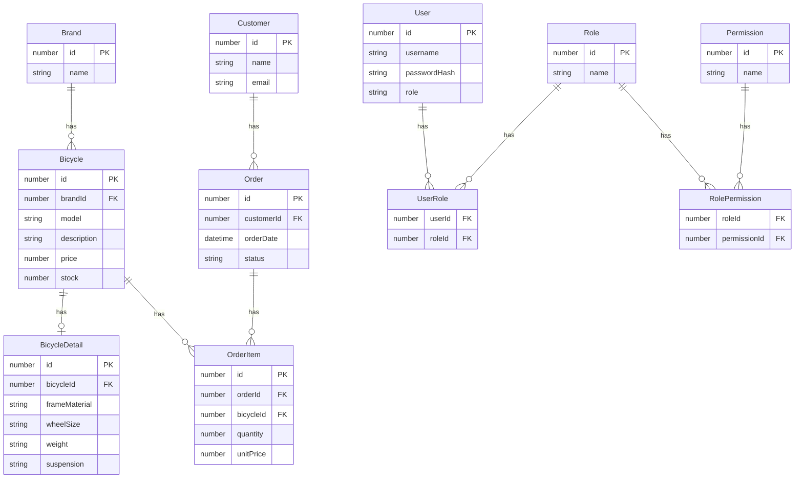

# Bicycle Shop

Web Application Example for educational purposes. 

It contains:
* Frontend:
    - built with React + tailwind CSS + headless UI. 
    - Connects to the backend via REST API, using basic and token bearer authentication.
    - It has a simple UI for login, registration, and CRUD operations for bicycles and their brands.
* Backend:
    - Built with Node.js + Express + Sequelize + PostgreSQL. 
    - It provides REST API endpoints for the frontend.
    - Basic Authentication for login and registration
    - Token Bearer Authentication for protected endpoints.
    - End-points with BRUNO
    - 7 tables: users, bicycles, brands, bicycle_details, customers, orders and order_items.
    - Sequelize migrations and seeders for database initialization.
    - Sequelize models for each table with relationships.
    - Sequelize queries for CRUD operations, and eager loading for related data.

## Getting Started

These instructions will get you a copy of the project up and running on your local machine for development and testing purposes.

### Prerequisites

You need a working environment with:
* [Git](https://git-scm.com) - You can install it from https://git-scm.com/downloads.
* [Node](https://nodejs.org) - Install node.js from https://nodejs.org/es/download/. It's advisable to install the LTS version.
* [VS Code](https://code.visualstudio.com/download) - Install Visual Studio Code from https://code.visualstudio.com/download/. It's advisable to install the LTS version.
* [PostgreSQL](https://www.postgresql.org/download/) - Install PostgreSQL from https://www.postgresql.org/download/. It's advisable to install the LTS version.
* [BRUNO](https://www.usebruno.com/download) - Install BRUNO from https://www.usebruno.com/download/. It's advisable to install the LTS version.

### Installing

Clone this project:

```
git clone https://github.com/tcrurav/TypeScript-Express-Sequelize-Associations_and_Queries-Example.git
```

Now install all dependencies.

```
cd TypeScript-Express-Sequelize-Associations_and_Queries-Example/frontend
npm ci
cd ../backend
npm ci
```

Edit backend/.env.development to set the database connection parameters.

Copy the frontend/.env.example file to frontend/.env and edit it to set the backend url. (the default is http://localhost:3000/api)

```
cp .env.example .env
```

Create a new database in PostgreSQL called ```bicycle_shop``` and run the migrations and seeders to initialize the database.

```
cd ../backend
npm run db:migrate
npm run db:seed
```

Run the project to see the resulting page:

```
cd backend
npm run dev
cd ../frontend
npm run dev
```

You can now access the frontend at http://localhost:5173 and the backend at http://localhost:3000/api.

Enjoy! 

## ER Diagram



## RBAC (Role-Based Access Control)

The application implements Role-Based Access Control (RBAC) to manage user permissions.

Three roles are defined:

- **ADMIN**: Full access to the application.
- **MANAGER**: Can manage bicycles, inventory, and orders.
- **CUSTOMER**: Can browse bicycles and create and view their own orders.

### RBAC Permissions Matrix

| Permission | ADMIN | MANAGER | CUSTOMER |
|---|:---:|:---:|:---:|
| `bicycles:read` | ✅ | ✅ | ✅ |
| `bicycles:create` | ✅ | ✅ | ❌ |
| `bicycles:update` | ✅ | ✅ | ❌ |
| `bicycles:delete` | ✅ | ❌ | ❌ |
| `orders:read` | ✅ | ✅ | ✅* |
| `orders:create` | ✅ | ✅ | ✅ |
| `orders:update` | ✅ | ✅ | ❌ |
| `users:manage` | ✅ | ❌ | ❌ |
| `roles:manage` | ✅ | ❌ | ❌ |

**Notes:**

- `ADMIN` has all permissions.
- `MANAGER` can manage bicycles and orders but cannot delete bicycles or manage users and roles.
- `CUSTOMER` has limited permissions.
- (*) Customers can only view their own orders. This restriction requires an additional ownership check.
- Permissions are assigned to roles, and roles are assigned to users through many-to-many relationships.
- Authentication uses JWT Bearer Tokens, while authorization is enforced through RBAC middleware.
- The backend is responsible for enforcing permissions, regardless of frontend restrictions.

## Built With

* [Git](https://git-scm.com) - You can install it from https://git-scm.com/downloads.
* [Node](https://nodejs.org) - Install node.js from https://nodejs.org/es/download/. It's advisable to install the LTS version.
* [VS Code](https://code.visualstudio.com/download) - Install Visual Studio Code from https://code.visualstudio.com/download/. It's advisable to install the LTS version.
* [PostgreSQL](https://www.postgresql.org/download/) - Install PostgreSQL from https://www.postgresql.org/download/. It's advisable to install the LTS version.
* [BRUNO](https://www.usebruno.com/download) - Install BRUNO from https://www.usebruno.com/download/. It's advisable to install the LTS version.
* [Vite](https://vite.dev/) - The Build Tool for the Web

## Acknowledgments

* https://gist.github.com/sc1f/12ad9c209a87678b49f4507abf458138. Pushing the contents of your dist folder to gh-pages.
* https://gist.github.com/PurpleBooth/109311bb0361f32d87a2. A very complete template for README.md files.
