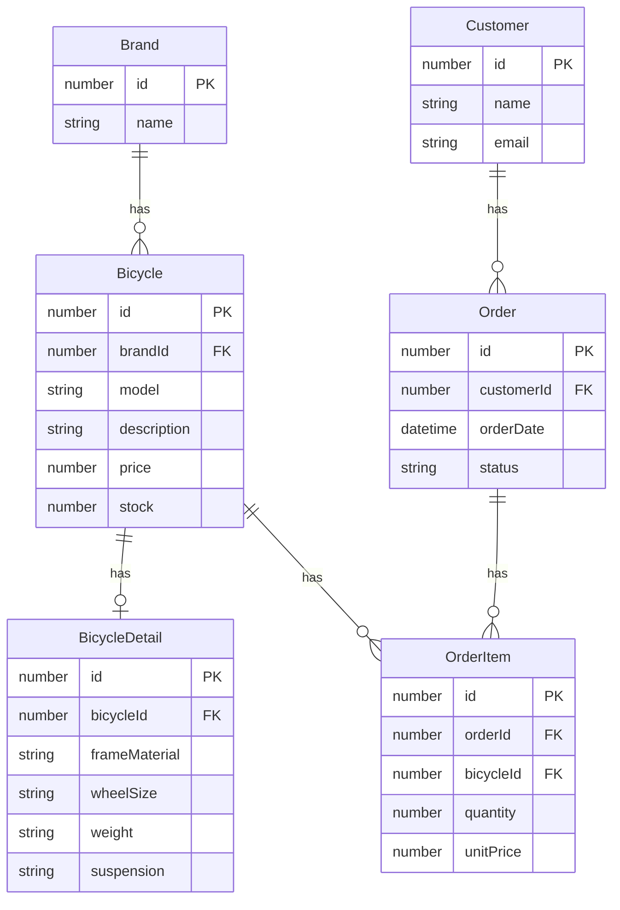
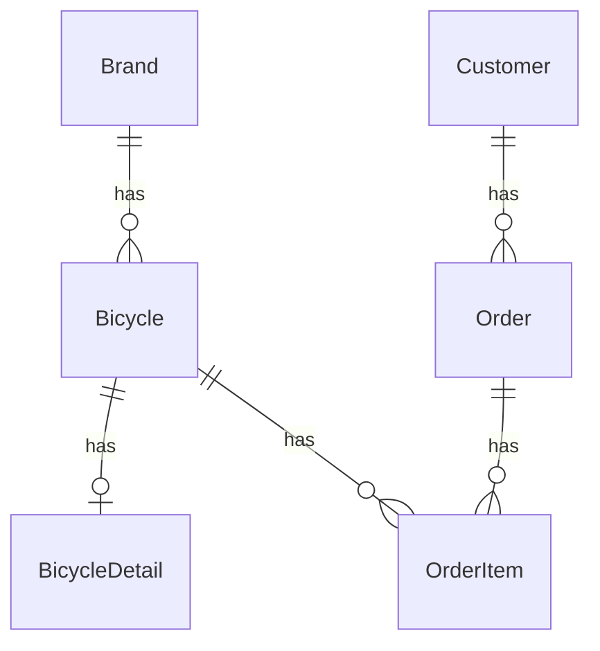
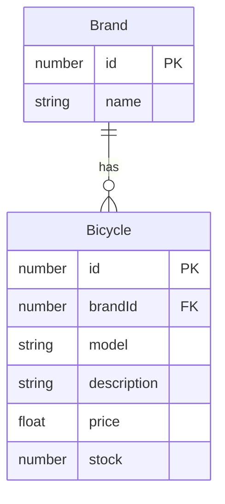
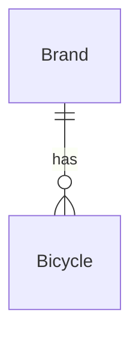
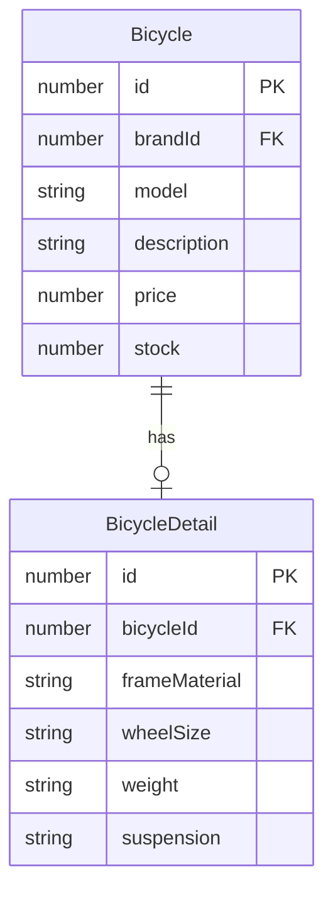
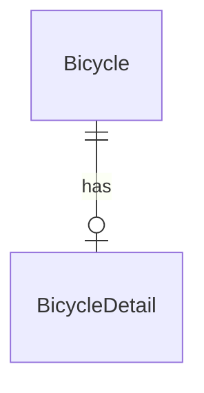
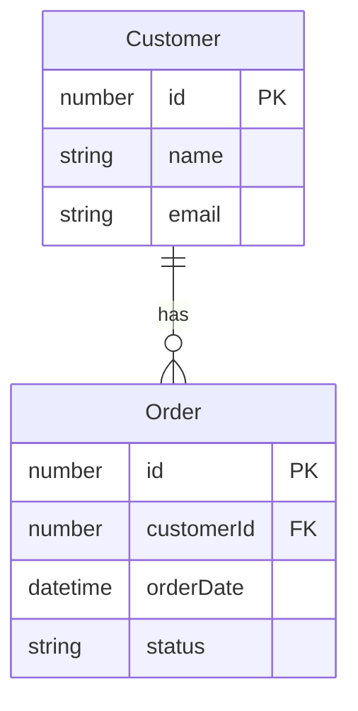
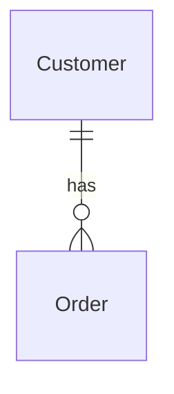
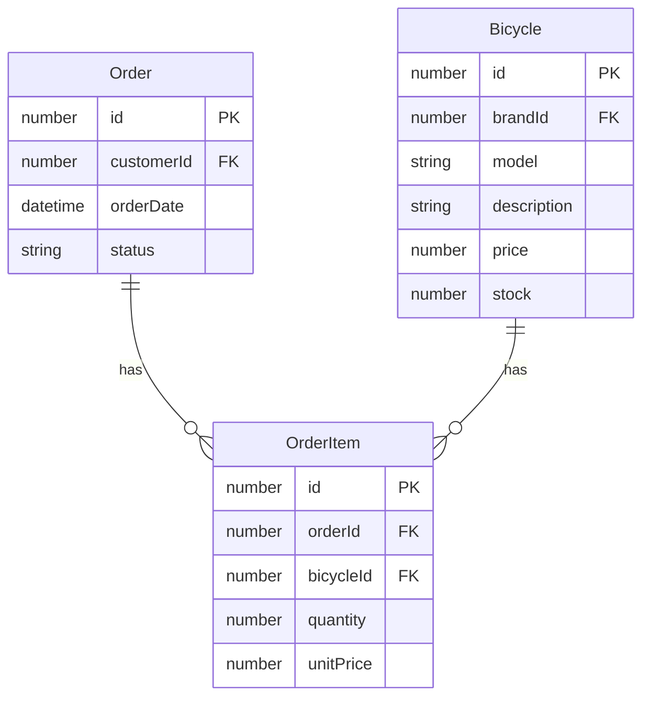
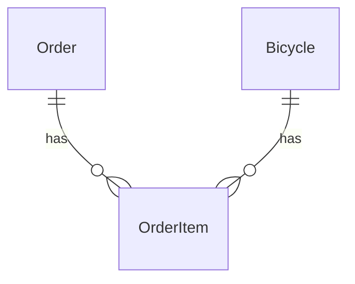

## Full Entity-Relationship Diagram (ERD) (with fields)

## Full Entity-Relationship Diagram (ERD) (without fields)

## Entity-Relationship Diagram (ERD) Brand 1:N Bicycle

## Entity-Relationship Diagram (ERD) Brand 1:N Bicycle

## Entity-Relationship Diagram (ERD) Bicycle 1:1 BicycleDetail

## Entity-Relationship Diagram (ERD) Bicycle 1:1 BicycleDetail

## Entity-Relationship Diagram (ERD) (with fields)

## Entity-Relationship Diagram (ERD) (without  fields)

## Entity-Relationship Diagram (ERD) (with fields)

## Entity-Relationship Diagram (ERD) (without fields)

